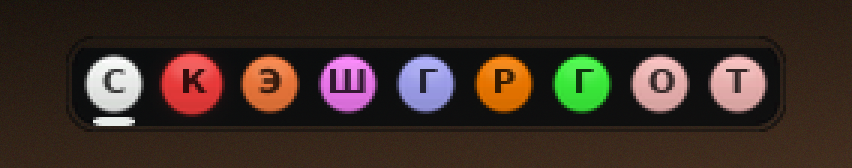
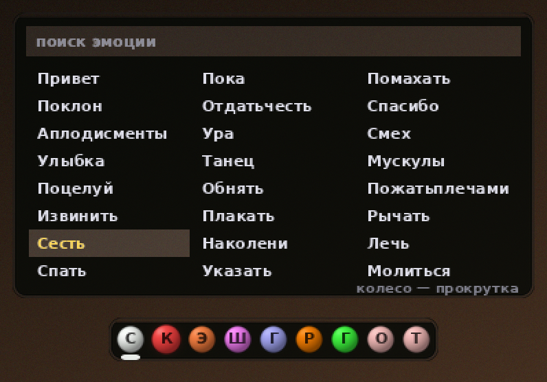
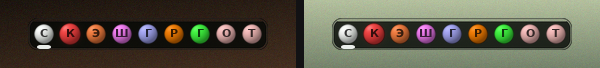
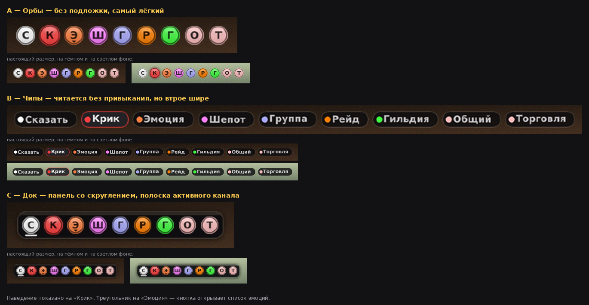

# ChatOrbs

Компактная панель каналов чата для World of Warcraft: круглые цветные кнопки в
тёмном доке, по одной на каждый доступный канал. Щелчок — и строка ввода уже
переключена на нужный канал. Кнопка эмоций открывает список, чтобы не набирать
`/танец` руками.



Под активным каналом загорается полоска — на картинке это «Сказать». Видно,
куда вы сейчас пишете; в самом клиенте это понятно только по надписи в строке
ввода. Кнопка под курсором подсвечивается и подрастает — здесь это «Крик».

Буквы: **С**казать, **К**рик, **Э**моция, **Ш**епот, **Ш**епот Battle.net,
дальше номерные каналы — **О**бщий, **Т**орговля и так далее.

### Эмоции в один щелчок



В списке **все эмоции, которые знает клиент**, а не заранее выбранная горстка:
ходовые идут первыми, остальные следом по алфавиту. Сверху поиск — он находит
и по русскому названию, и по английскому токену, регистр не важен. Enter
выполняет первое совпадение, колесо прокручивает, Esc закрывает.

Названия берутся из слэш-команд самого клиента, поэтому список локализован
автоматически. Правый щелчок по той же кнопке открывает `/e` для своей эмоции
текстом.

### Настоящий размер



Панель занимает примерно 250 × 32 пикселя — слева на тёмном фоне, справа на
светлом. Масштаб меняется командой `/chatorbs scale`.

## Установка

1. Распакуйте `ChatOrbs.zip`.
2. Скопируйте папку `ChatOrbs` в `Interface/AddOns/`.
3. Полностью перезапустите игру и включите ChatOrbs в списке аддонов.

```
Interface/AddOns/ChatOrbs/
├── ChatOrbs.toc
├── ChatOrbs.lua
└── Textures/
    ├── Orb.blp        сфера, окрашивается цветом канала
    ├── OrbSheen.blp   блик поверх сферы
    ├── Glow.blp       свечение при наведении
    ├── Panel.blp      подложка дока и окна эмоций
    └── Marker.blp     полоска активного канала
```

## Команды

| Команда | Действие |
| --- | --- |
| `/chatorbs` | список команд |
| `/chatorbs lock` | запретить перемещение |
| `/chatorbs unlock` | разрешить перемещение |
| `/chatorbs reset` | вернуть положение и масштаб по умолчанию |
| `/chatorbs scale 1` | масштаб панели (0.5 – 3), подгоняется под пиксельную сетку |
| `/chatorbs hide` | скрыть панель |
| `/chatorbs show` | показать панель |
| `/chatorbs flat` | режим без текстур, если вместо кнопок зелёные квадраты |

Панель перетаскивается мышью за любую кнопку или за свободное место дока.
Положение, масштаб, блокировка и видимость хранятся в `ChatOrbsDB`
(SavedVariables, одна запись на аккаунт).

## Управление

- **Щелчок по кнопке** — открыть строку ввода в этом канале.
- **Щелчок по «Шепот»** — если выбран дружественный игрок, шепот уходит ему;
  иначе в строку подставляется `/w `, и получателя вы вводите сами.
- **Щелчок по «Эмоция»** — список эмоций, выполняются одним щелчком.
- **Правый щелчок по «Эмоция»** — строка `/e` для своей эмоции текстом.
- **Esc** — закрыть список эмоций.

## Как формируется ряд кнопок

Кнопки не зашиты в код: ряд перестраивается из состояния игры.

Всегда: Сказать, Крик, Эмоция, Шепот, Шепот Battle.net.
По условию: Группа, Рейд, Подземелье, Гильдия, Офицерский.
Затем: все номерные каналы из `GetChannelList()` по порядку.

Буква — первый символ локализованного названия канала (`SAY` → «Сказать» → С,
канал «Торговля» → Т). Цвет берётся из `ChatTypeInfo`, то есть следует
настройкам цветов чата игрока.

## Чёткость: привязка к пиксельной сетке

Интерфейс WoW размечен на сетке высотой **768 единиц**, и одна единица
занимает `масштаб × высота экрана / 768` физических пикселей. Если это число
не целое, каждый край каждой текстуры попадает между двумя пикселями — панель
выглядит мыльной и рябит. На 1080p при масштабе 1 единица равна 1.40625
пикселя, то есть ровно этот случай.

Поэтому аддон подгоняет **свой собственный** масштаб до ближайшего целого или
половинного числа пикселей на единицу, а угол панели округляет на целый
пиксель. Остальной интерфейс при этом не трогается — специальные аддоны вроде
PixelPerfectUI делают то же самое, но для всего `UIParent` сразу.

Из-за этого `/chatorbs scale 1.5` может дать, например, 1.422 — так и надо,
команда сообщит подогнанное значение. Все размеры в коде чётные, чтобы шаг в
полпикселя всё равно давал целые края.

## Текстуры

`tools/make_textures.py` рисует все пять текстур с нуля — ни скриншотов, ни
чужой графики. Записываются в **BLP2 / DXT5** 128×128 с полной цепочкой мип-уровней —
в этом формате лежит вся графика самой игры.

Шар считается как настоящая сфера: по нормали к поверхности берётся рассеянный
свет сверху-слева, край затемняется к ободу, поверх отдельным слоем идёт блик.
Плоская заливка на маленьком размере выглядит дёшево, объёмная — нет.

Первая версия писала палитровый вариант BLP2. Клиент его не принял и рисовал
вместо кнопок зелёные квадраты — так он показывает ненайденную текстуру.
Поэтому палитровый путь убран, а каждый файл после записи декодируется обратно
читалкой BLP из Pillow (независимая реализация формата) и сравнивается с
исходником попиксельно.

Сфера разделена на два слоя, потому что `SetVertexColor` умеет только
затемнять: кольцо и вертикальный спад — это умножение и живут в `Orb`, а блик
должен осветлять, поэтому ему нужен свой слой.

```
python3 tools/make_textures.py     # перерисовать текстуры
python3 tools/preview.py           # собрать картинки в docs/ из готовых BLP
python3 tools/mockups.py           # перерисовать docs/variants.png
```

Все картинки в `docs/` собираются из тех же BLP, которые лежат в аддоне:
`tools/preview.py` декодирует их независимым декодером, написанным по
спецификации формата, и компонует ровно так, как это сделает игра. То есть это
не рисунки, а проверка — если бы кодировщик BLP был сломан, картинки бы
развалились.

<details>
<summary>Почему именно такой вид</summary>

Прежде чем писать аддон, были нарисованы три варианта: только кружки без
подложки, таблетки с полными названиями каналов и док. Выбран док — он
показывает активный канал и за него удобно таскать панель мышью.



Таблетки читаются без привыкания, но ряд выходит втрое шире и заметно
перекрывает экран.

</details>

## Проверки

`tools/test_chatorbs.lua` загружает аддон в макет WoW API под Lua 5.1 (версия,
на которой работает игра) и прогоняет вход в игру, все команды, нажатия,
наведение, перетаскивание, список эмоций, события смены группы, рейда, гильдии
и каналов. Любой метод виджета, которого нет в макете, роняет прогон — опечатка
не проходит молча.

```
python3 - <<'EOF'
from lupa import lua51
L = lua51.LuaRuntime(unpack_returned_tuples=True)
L.eval('function(p, a) return assert(loadfile(p))(a) end')('tools/test_chatorbs.lua',
                                                           'ChatOrbs/ChatOrbs.lua')
EOF
```

## Версия клиента

`## Interface: 16001, 120100, 120105` — 16001 для WoW: Forever, остальные для
Retail. Клиент выбирает ближайшее значение, не превышающее его собственную
версию интерфейса. Проверить свою:

```
/dump select(4, GetBuildInfo())
```

Если число отличается, замените первое значение в `ChatOrbs.toc`.

## Публикация

Графика и код свои, лицензия MIT, имя папки совпадает с именем `.toc` — архив
готов к загрузке на CurseForge. Первая загрузка проходит ручную модерацию;
не забудьте проставить игровую версию, иначе аддон не будет находиться.
